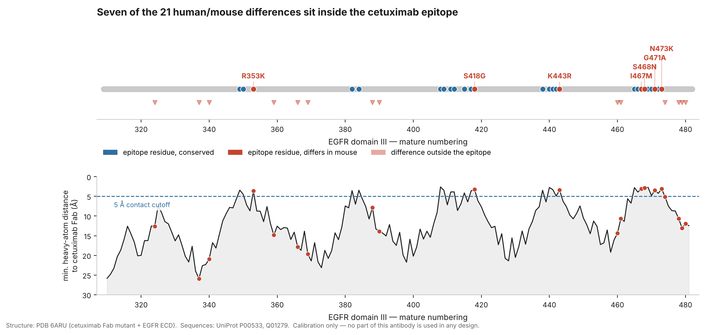

# Conditional EGFR Binder — Target Analysis

Target-side analysis for a pH-selective, human/mouse cross-reactive EGFR
binder. Built as a solo entry to Challenge 1 of the Anthropic × Adaptyv
Protein Design Competition.

This repository holds the **target characterisation**: which part of EGFR a
cross-reactive binder can safely aim at, and where the human/mouse
differences actually sit. Every number below is produced by a script in
`analysis/` and reproduces from the data in `data/`.

---

## The design problem

A binder that satisfies all three of the following at once:

| Requirement | Why it constrains the others |
|---|---|
| Binds human **and** mouse EGFR | Forces the epitope onto conserved surface — shrinks the usable design space |
| Binds at pH 6.5, not at pH 7.4 | Typically needs histidines at the interface, but His placement is limited to wherever the conserved patch is |
| De novo | No existing binder to borrow affinity from |

Self-imposed constraint: **de novo only**. No grafting, no mutating a known
binder.

---

## Result 1 — Domain III is 87.8% conserved, and the differences are not evenly spread

Domain III (mature numbering 310–481, 172 residues) compared across species:

- **151 / 172 identical — 87.8%**
- **21 differences**

Density by 20-residue window:

```
310-329   1  #
330-349   2  ##
350-369   4  ####
370-389   1  #
390-409   1  #
410-429   1  #
430-449   1  #
450-469   4  ####
470-481   6  ######
```

**Ten of the 21 differences fall in the last 32 residues (450–481).** The
C-terminal end of domain III is where the two species diverge; the rest is
close to invariant.

**Design implication:** an epitope that overlaps 450–481 buys a
cross-reactivity problem for nothing. The conserved stretch from roughly
370 to 450 carries only 4 differences across 80 residues and is the better
place to aim.

Full variant list: `python analysis/01_domain3_alignment.py`

Reproduce: `python analysis/01_domain3_alignment.py`

---

## Result 2 — The pipeline reproduces a known experimental fact

6ARU is a cetuximab Fab mutant bound to the EGFR extracellular region, so
the structure hands over a real, therapeutically relevant epitope to measure
against.

Taking every EGFR residue with a heavy atom within 5 Å of the Fab:

- the epitope is **26 residues**, all of them inside domain III
- **19 conserved, 7 differ in mouse — 27% divergent**
- four of those seven are packed into the nine residues 465–473
- the two closest contacts of all are species differences: **S468N at 2.82 Å
  and I467M at 3.05 Å**



Cetuximab is experimentally known not to bind mouse EGFR. This analysis uses
no experimental binding data at all — only a sequence comparison and one
crystal structure — and independently recovers the structural reason why.
That is the sanity check for everything downstream: a pipeline that could
not explain a known negative result would not be worth trusting on an
unknown one.

**Design implication:** the surface that makes the best therapeutic epitope
in humans is exactly the surface that breaks cross-reactivity. A design
aiming at both species cannot simply copy where cetuximab binds.

Reproduce: `python analysis/04_epitope_conservation.py`

**Scope limit:** cetuximab defines one binding surface on EGFR, not the only
one. These results show that these positions are *capable* of sitting at a
protein–protein interface — not that every possible binder must avoid them.

---

## Result 3 — The source files are not interchangeable, and the checks say why

Three traps in the input data, all caught by `analysis/00_verify_sources.py`:

**The mouse sequence is a precursor.** It carries a 24-residue signal
peptide; the human file does not. Naive index-matching between the two
files is off by 24 throughout. The scripts locate the mature start by motif
rather than hard-coding the offset, so a swapped file fails loudly instead
of silently producing a wrong identity figure.

**The structure is a construct, not the native protein.** 6ARU chain A
differs from the reference human sequence at 7 positions in the overlap
(516 N→K, 610 E→R) plus a C-terminal His-tag. All of them fall **outside**
domain III, so the alignment above is unaffected — but the check runs every
time rather than being assumed.

**Residue numbering must be verified against the structure, not trusted.**
`analysis/03_scan_variant_contacts.py` reads the amino acid actually present
at each position in the PDB and compares it to what the sequence alignment
predicts, flagging any mismatch before reporting a distance.

Reproduce: `python analysis/00_verify_sources.py`

---

## On the antibody in 6ARU

Chains B and C of 6ARU are an antibody. Contact distances measured against
them are used only to calibrate which EGFR surface positions are capable of
sitting at a protein–protein interface. **No part of that antibody is used,
grafted, or mutated into any design.** This repository contains no design
sequences.

---

## Layout

```
data/sequences/     human (mature) and mouse (precursor) EGFR
data/structures/    6ARU chain A sequence; PDB file downloaded separately
analysis/           every script that produces a number in this README
designs/            candidate sequences — only ones actually generated
docs/               methods write-up
figures/            output figures
```

The 6ARU PDB file (1.3 MB) is not committed. Fetch it with:

```bash
curl -o data/structures/6ARU.pdb https://files.rcsb.org/download/6ARU.pdb
```

---

## Running it

```bash
python analysis/00_verify_sources.py         # source checks — run first
python analysis/01_domain3_alignment.py      # identity, variants, density
python analysis/02_single_site_contacts.py   # one site vs the Fab
python analysis/03_scan_variant_contacts.py  # all 21 variants vs interface
python analysis/04_epitope_conservation.py   # epitope definition + conservation
python analysis/05_make_figure.py            # figures/domain3_epitope_map.png
```

Scripts 00–04 use only the Python standard library. Script 05 needs
matplotlib.

---

## Rules this repository follows

1. **No invented sequences.** Anything in `designs/` came out of a logged
   model run.
2. **No unrun numbers.** Every figure in this README has a script above it
   that produces it.
3. **Sources are verified, not assumed.** Offsets, construct differences
   and residue numbering are checked by code, not by eye.

---

## Sources

| What | Where |
|---|---|
| Human EGFR | UniProt P00533 |
| Mouse EGFR | UniProt Q01279 |
| Structure | PDB 6ARU — cetuximab Fab mutant bound to EGFR ECD |
| Challenge | Anthropic × Adaptyv Protein Design Competition, Challenge 1 |

---

## Author

Final-year pharmaceutical science undergraduate, TU Dublin.
Working on computational protein design, in public.
X: [@wongyong_fan](https://x.com/wongyong_fan)
